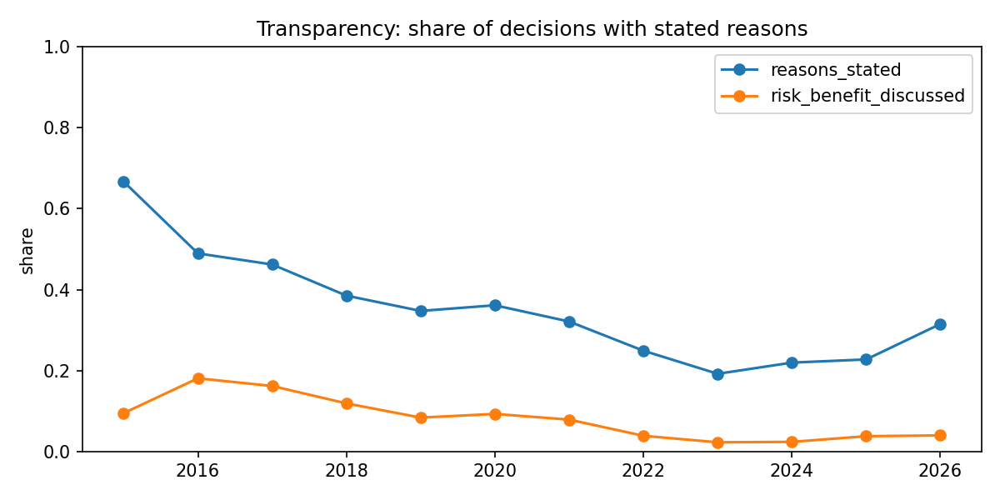

# RegWatch

RegWatch turns the published meeting minutes of India's drug regulator into a structured dataset.

CDSCO's Subject Expert Committees (SECs) review applications for clinical trials, bioequivalence
studies, new drugs and label changes. They publish their recommendations as PDFs. Each PDF is a table
of agenda items: the file number, drug, firm and the committee's recommendation. RegWatch downloads
every PDF and splits it into agenda items. An LLM then extracts structured fields from each item,
and the extraction is scored against hand-labelled examples.

The corpus: 1,864 PDFs, 14,121 agenda items and 13,866 committee decisions from 2015 to 2026.
The write-up is in [`paper/regwatch_paper.md`](paper/regwatch_paper.md).

## Results

**Extraction quality.** `gemini-3.5-flash-lite` against 200 hand-labelled items
([`results/extraction_eval.csv`](results/extraction_eval.csv)):

| Field | Accuracy | Macro-F1 | Cohen's κ |
|---|---|---|---|
| `decision` | 0.88 | 0.87 | 0.84 |
| `request_type` | 0.80 | 0.78 | 0.74 |
| `local_ct_waiver_requested` | 0.99 | 0.97 | 0.93 |
| `is_decision` | 0.99 | 0.83 | 0.66 |
| `reasons_stated` | 0.81 | 0.80 | 0.60 |

**What the decisions show** ([`results/stats.json`](results/stats.json), `results/decisions_by_*.csv`):

- Committees state a reason far less often than they used to: about 47% of decisions in 2016–17,
  about 21% in 2023–25. Explicit risk–benefit discussion fell from 18% (2016) to under 5% since 2022.
- Requests to waive a local clinical trial have 7.5× the odds of rejection (1,276 requests,
  Fisher exact p ≈ 3×10⁻¹²⁹).
- The decision mix shifted across regulatory eras (χ² = 183, p ≈ 5×10⁻³¹): outright rejections fell
  from 10.6% before the 2019 NDCT Rules to 5.3% from 2022, while deferrals rose from 10.2% to 15.9%.



**Predicting the decision from the request alone.** The input is only the text before the
committee's verdict, so the label cannot leak. Test = later years; gold = the hand-labelled items
([`results/predictor_eval.csv`](results/predictor_eval.csv),
[`results/predictor_eval_bert.csv`](results/predictor_eval_bert.csv)):

| Model | Test macro-F1 | Test κ | Gold macro-F1 | Gold κ |
|---|---|---|---|---|
| Majority class | 0.10 | 0.00 | 0.07 | 0.00 |
| TF-IDF + gradient boosting | 0.49 | 0.37 | 0.48 | 0.33 |
| Fine-tuned BiomedBERT | 0.53 | 0.39 | 0.53 | 0.38 |

The request carries real signal about the outcome, but most of the decision depends on deliberation
the minutes don't record.

## Pipeline

| Step | Script | Input | Output |
|---|---|---|---|
| 1. Download | `download_sec.py` | CDSCO SEC page | `data/index.csv`, `data/pdfs/`, `data/text/`, `data/stats.csv` |
| 2. Segment | `segment.py` | PDFs | `data/items.jsonl` (one agenda item per line) |
| 2b. OCR | `ocr.py` | scanned PDFs | agenda items appended to `data/items.jsonl` |
| 3. Extract | `extract.py` | agenda items | `data/extracted.jsonl` (structured fields per item) |
| 4. Sample | `make_label_sample.py` | items | `labels/to_label.csv` (200 items for labelling) |
| 5. Label sheet | `make_label_sheet.py` | sample | `labels/gold.xlsx` (dropdown-only labelling sheet) |
| 6. Evaluate | `evaluate.py` | hand labels + extraction | `results/extraction_eval.csv` |
| 7. Analyse | `analyze.py` | extraction + index | `results/decisions_by_*.csv`, `results/transparency_by_year.*`, `results/stats.json` |
| 8. Predict | `predict.py`, `predictor_pubmedbert.ipynb` | request text + labels | `results/predictor_eval.csv`, `results/predictor_eval_bert.csv` |

### 1. Download (`download_sec.py`)
- Parses the SEC listing page into an index of every PDF (title, release date, category, size, URL).
  An assertion checks that every download link on the page was parsed.
- Downloads with 4 workers and retries with exponential backoff. Some links return an HTML wrapper
  instead of the file; the script follows the wrapper to the real PDF. Responses that aren't PDFs are
  reported, not saved.
- Extracts text with PyMuPDF. A PDF with fewer than 200 characters per page has no text layer, so
  it's flagged as scanned. Corrupt PDFs are recorded and skipped.
- Re-runnable: files already on disk are skipped.

### 2. Segment (`segment.py`)
- Reads each PDF's tables with PyMuPDF and turns table rows into agenda items. It handles:
  - section headings such as "GCT Division"
  - merged cells that repeat their text
  - rows continued across page breaks
- Column layouts differ between years, so cells are kept in order and the LLM assigns fields.
- Scanned PDFs are skipped. Runs in parallel, and includes an assert-based self-check of the row
  parser.

### 3. Extract (`extract.py`)
- Sends agenda items to any OpenAI-compatible endpoint (Gemini by default) in batches of 10, with
  JSON output and temperature 0.
- Each item becomes one record with these fields:
  - `is_decision`
  - `file_no`, `drug`, `firm`, `product_type`
  - `request_type`: clinical trial, BE study, new drug, new indication or change, protocol
    amendment, post-marketing, or other
  - `ct_phase`
  - `local_ct_waiver_requested`, `waiver_granted`
  - `decision`: approved, approved with conditions, rejected, more info requested, deferred, or other
  - `reasons_stated`, `reason_summary`
  - `conditions`
  - `risk_benefit_discussed`
- The prompt tells the model to use only what the text says and not to guess.
- Reliability:
  - A global rate limit keeps it within free-tier quotas.
  - Transient errors are retried with backoff. Authentication and model errors fail fast.
  - A batch whose response is missing any input keys is retried.
  - Runs are resumable: items already in `data/extracted.jsonl` are skipped.

### 4–6. Evaluation
- `make_label_sample.py` draws 200 items stratified by year, with a fixed seed, so later years with
  more meetings don't dominate the sample.
- `make_label_sheet.py` builds an Excel sheet with dropdowns for each label and a "how to label"
  guide tab. It refuses to overwrite an existing `gold.xlsx`, which holds the hand labels.
- `evaluate.py` compares the extraction with the hand labels on five fields: `is_decision`,
  `request_type`, `local_ct_waiver_requested`, `decision` and `reasons_stated`. For each field it
  reports accuracy, macro-F1 and Cohen's kappa.

### 2b. OCR (`ocr.py`)
- Runs Tesseract on the 65 scanned PDFs that have no text layer and appends their agenda items to
  `data/items.jsonl`. It only appends, so existing item keys and the hand labels never shift.

### 7. Analyse (`analyze.py`)
- Decision mix by year, committee, request type and regulatory era (pre-2019, the 2019 NDCT Rules,
  COVID 2020–21, 2022 onward), with a χ² test across eras.
- Share of decisions that state a reason or discuss risk–benefit, by year.
- Odds of rejection when a local-trial waiver is requested (Fisher's exact test).

### 8. Predict (`predict.py`, `predictor_pubmedbert.ipynb`)
- Only the request part of each item (the text before the committee's verdict) is used as input.
- Split by time: train on 2022 and earlier, test on 2023 onward. The hand-labelled items are held out
  as a second test set, scored against the human labels.
- `predict.py` trains the majority-class and TF-IDF + gradient-boosting baselines on CPU. The notebook
  fine-tunes BiomedBERT on a free Colab GPU.

### Labels (`labels/`)
- `gold.xlsx`: the 200 hand-labelled items used for every score above.
- `gold_v1.xlsx`: the first labelling pass. The labelling guide was then tightened (rules R1–R4) and
  82 labels were changed; every change and its reason is in `relabel_log.csv`. Agreement between v1
  and v2 is κ = 0.75 for both `request_type` and `decision`.
- `claude_labels.xlsx`, `human_verified.xlsx`: an earlier LLM-annotated reference set and the
  40-item human check of it, kept for the record. They are superseded by `gold.xlsx`.

## Setup

Requires Python 3. OCR also needs Tesseract (`winget install UB-Mannheim.TesseractOCR` on Windows).

```bash
pip install -r requirements.txt
```

Create a `.env` file next to the scripts. It is git-ignored; never commit it.

```
LLM_BASE_URL=https://generativelanguage.googleapis.com/v1beta/openai/
LLM_MODEL=gemini-3.5-flash-lite
LLM_API_KEY=your-key
# Optional: LLM_BATCH=10  LLM_WORKERS=2  LLM_RPM=12
```

## Usage

```bash
python download_sec.py        # 1. download and extract text
python segment.py             # 2. split PDFs into agenda items
python ocr.py                 # 2b. OCR the scanned PDFs (appends items)
python extract.py [limit]     # 3. LLM extraction (resumable; re-run to retry failed batches)
python make_label_sample.py   # 4. pick 200 items to label
python make_label_sheet.py    # 5. build labels/gold.xlsx, then label it by hand
python evaluate.py            # 6. score the extraction against the labels
python analyze.py             # 7. trends and tests -> results/
python predict.py             # 8. decision-prediction baselines (BiomedBERT: run the notebook on Colab)
```

## Limitations
- **LLM labels.** The trends and the prediction targets are LLM outputs. Their reliability is bounded
  by the agreement with the hand labels (κ 0.60–0.93 depending on the field).
- **Single annotator.** The 200 gold items were labelled by one person, and the v2 revision was done
  with LLM assistance, which may bias the gold labels toward the model's behaviour. Mitigations:
  written rules, a full change log, and both versions kept.
- **OCR coverage.** 11 of the 65 scanned PDFs yielded no items, and OCR items lose their table structure.
  Other PDFs that yield no items are listed in `data/segment_empty.txt`.
- **Dates.** Years are release years, not meeting dates, so late-December meetings can shift by one year.
- **Coverage.** 2015 is thin (21 decisions); agenda items under 80 characters are not extracted.
- **Associations, not causes.** The era and waiver results describe what the minutes record, not why.

## Data
All source documents are public minutes from the CDSCO website. The `data/` folder is git-ignored,
so this repository contains the code, labels, results and paper, not the downloaded PDFs or the
extracted dataset. Downloads use a modest
level of concurrency and identify themselves with a descriptive User-Agent.
